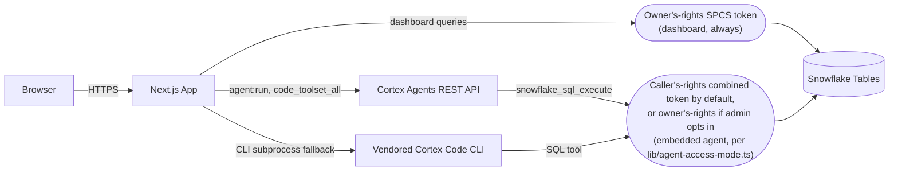
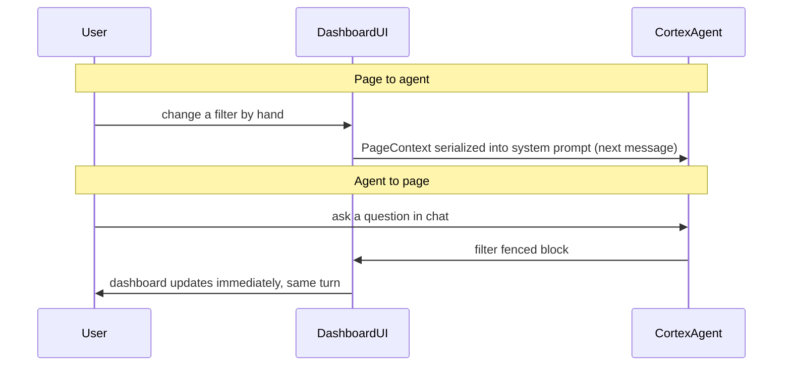

# Implementing Cortex Agents in Apps (BvA Variance Setup Case Study)

A Next.js web app that configures and displays a Budget vs. Actuals (BvA) dashboard from a customer's own Snowflake tables. It includes an embedded Cortex Agent that helps set it up and analyze it. This document describes how that agent integration works, why it's built this way, and how to apply the same pattern to other apps.

**Runs on Snowflake App Runtime** (a Next.js app deployed to Snowpark Container Services, inside Snowflake's security perimeter). For platform-level setup before this app specifically, see the [App Runtime getting started guide](https://docs.snowflake.com/en/developer-guide/snowflake-app-runtime/getting-started).

**This document explains the design decisions behind this app's Cortex Agent integration and why they were made.** For the literal step-by-step "how to wire this up" mechanics, see the collapsed walkthrough in [§13](#13-applying-this-to-other-reactstreamlit-apps).

> New to this app? Start with [§1](#1-tldr) for the two-minute summary, [§16](#16-codebase-organization) for where everything lives, [§17](#17-distributing-this-as-a-skill) for how it's packaged and deployed, and [§10](#10-permissions-owners-rights-vs-callers-rights) for the one security tradeoff every deployment has to make a deliberate decision about.

## Table of contents

1. [TL;DR](#1-tldr)
2. [Architecture at a glance](#2-architecture-at-a-glance)
3. [What "Cortex Agent" means here](#3-what-cortex-agent-means-here)
4. [The page and CoCo are one surface, not two](#4-the-page-and-coco-are-one-surface-not-two)
5. [Query accuracy: one source of truth](#5-query-accuracy-one-source-of-truth)
6. [Table discovery, and its tradeoff](#6-table-discovery-and-its-tradeoff)
7. [Setup flow: manual wizard ↔ CoCo-assisted setup](#7-setup-flow-manual-wizard--coco-assisted-setup)
8. [Rehydration flow: redesigned from a chat-only skill](#8-rehydration-flow-redesigned-from-a-chat-only-skill)
9. [System prompt best practices](#9-system-prompt-best-practices)
10. [Permissions: owner's rights vs. caller's rights](#10-permissions-owners-rights-vs-callers-rights)
11. [Guardrails](#11-guardrails)
12. [Deploying this](#12-deploying-this)
13. [Applying this to other React/Streamlit apps](#13-applying-this-to-other-reactstreamlit-apps)
14. [Custom logic layer and semantic views](#14-custom-logic-layer-and-semantic-views)
15. [Customer implementation](#15-customer-implementation)
16. [Codebase organization](#16-codebase-organization)
17. [Distributing this as a skill](#17-distributing-this-as-a-skill)
18. [Further reading](#18-further-reading)

---

## 1. TL;DR

This app has two jobs: a **setup wizard** that maps a customer's raw GL/budget/cost-center tables into a valid BvA config, and a **dashboard** that renders BvA analysis from that config. Both are backed by an embedded Cortex Agent, one system prompt for setup, one for analysis, sharing a single agent thread (see [§4](#4-the-page-and-coco-are-one-surface-not-two)). That agent talks to the same Snowflake tables and connection the human-driven UI uses.

Four design choices, covered in their own sections: the agent and the page stay in sync automatically ([§4](#4-the-page-and-coco-are-one-surface-not-two)), the agent is steered toward the same numbers the dashboard already shows rather than recomputing its own ([§5](#5-query-accuracy-one-source-of-truth)), agent-driven setup funnels through a real human save action ([§7](#7-setup-flow-manual-wizard--coco-assisted-setup)), and unsupervised writes are structurally append-only ([§11](#11-guardrails)). These are application-level decisions, not Snowflake platform features.

---

## 2. Architecture at a glance



(`code_toolset_all` is Cortex Agents' sandboxed, general-purpose tool bundle, covering SQL, file access, shell, and more; see [§3](#3-what-cortex-agent-means-here) for what it includes and how it compares to CoCo.)

Two points about this diagram:
- **Dashboard queries always run as the app's owner; the embedded agent runs as the signed-in viewer by default (caller's rights), unless an admin opts the whole app into owner's rights.** The dashboard authenticates with the app's SPCS service OAuth token (`/snowflake/session/token`) via `querySnowflake()` in `lib/snowflake.ts`: same identity for every viewer, no caller's-rights option, by design (see [§10](#10-permissions-owners-rights-vs-callers-rights)'s cache-isolation note for why this matters). The agent's identity is a separate, admin-controlled decision. See [§10](#10-permissions-owners-rights-vs-callers-rights).
- **The agent has two backends, chosen once per container lifetime:** `isRestBackendAvailable()` (`lib/agent-availability.ts`) probes the REST path at startup; if it's reachable, `runTurnRest()` calls `POST /api/v2/cortex/agent:run` via `fetch()`. If not, `runTurnCli()` spawns the vendored Cortex Code CLI as a subprocess. Both translate to the same JobEvent shapes, so the browser-facing polling contract is backend-agnostic. See the collapsed note below for the CLI fallback's history and the security difference between the two paths.

<details>
<summary>History: the vendored-CLI fallback (restored as a safety net alongside REST access)</summary>

**Why this exists:** `code_toolset_all` REST access requires `code_toolset_all` access on the account. `isRestBackendAvailable()` (`lib/agent-availability.ts`) probes once per container lifetime, and every turn silently falls back to a subprocess-based CLI backend whenever the probe fails. This is a deliberately conservative default: the app would rather under-use the newer REST path than fail entirely on an account where the feature isn't available, which matters for customer deployments where you can't assume it's on.

**What the CLI backend does:** `runTurnCli()` in `lib/agent-backend.ts` calls `createCortexCodeSession()` from the `cortex-code-agent-sdk` npm package, which spawns the vendored Cortex Code CLI as a child process and speaks to it over stdin/stdout using a `stream-json` control protocol, rather than calling `agent:run` over HTTP. It resolves a Snowflake connection via the SPCS service token when running in-container, and scopes the CLI's own tool access with `allowedTools: ["SQL"]` plus an explicit `disallowedTools` list (`Bash`, `Write`, `Edit`, `Read`, `Glob`, `Grep`, `WebSearch`, `WebFetch`), the CLI-era equivalent of this app's auto-approve/auto-deny logic in [§11](#11-guardrails).

**A real negotiation bug that shaped the final design:** an earlier version also passed a `canUseTool` callback to validate the SQL *text* sent through the allowed `SQL` tool (`allowedTools` only gates the tool *name*, not what SQL is sent through it). That was reverted: providing `canUseTool` made the SDK request `--permission-prompt-tool stdio` and `sdkManagedPermissions: true` on the CLI's `initialize` control request, a negotiation path the vendored CLI build in use never completed: every turn hung until the `initialize` request timed out. The fix was to rely on `allowedTools`/`disallowedTools` alone for the CLI path rather than risk breaking every turn for a stronger guarantee the CLI build couldn't actually deliver.

**The build-time problem, and how it was solved:** the CLI binary can't be installed at App Runtime build time (the build container has no `curl`/`wget` and no package manager, and DNS for install sources resolves `ENOTFOUND`). The fix: fetch the CLI tarball on the *deploying machine* via `scripts/vendor-cortex-cli.sh`, split it into small chunks committed into the project (`./vendor/coco-linux-amd64.tar.gz.part-*`), and reassemble + extract them as an `app.yml` install step at build time, no network call needed there. Run `sh scripts/vendor-cortex-cli.sh` once before deploy to (re)generate the chunks.

**Important security note:** the CLI fallback authenticates with the SPCS *service* token, not a per-user caller token. It always runs as the app's owner role, regardless of caller's rights configuration. See [§10](#10-permissions-owners-rights-vs-callers-rights) for the implications.

</details>

### Why this isn't a simple request/response, and why that matters for timeouts

**In short:** a single agent turn can take minutes, but SPCS closes any inbound request that doesn't get a response within about 90 seconds. This app never lets the browser wait on the agent directly. The browser only ever polls a small status endpoint on this app's own server, while the server itself talks to Cortex Agents on a separate connection, in the background.

| Leg | Protocol | Why it's not subject to the 90s limit |
|---|---|---|
| Container → Cortex Agents REST API | SSE, long-lived, consumed server-side by `runTurnRest()` | Never passes through this app's own inbound ingress proxy |
| Browser → container | Short polling, one `GET` every 1-2 seconds | Each poll completes in well under a second |

Concretely: the browser gets back a job id immediately, before the agent has produced anything, and polls that id every 1-2 seconds while the server tracks the SSE connection in the background. Neither connection ever waits on the full multi-minute turn. [§6](#6-table-discovery-and-its-tradeoff) reuses this same background-job/polling pattern for its own long-running scan.

Before wiring up the full chat flow, run one no-op `agent:run` call to confirm the REST path is reachable, and cache that result for the container's life rather than re-checking per message.

<details>
<summary>Minimal no-op call (illustrative, not a function in this codebase)</summary>

This app doesn't have a dedicated reachability-check function; this is the smallest request shape that would work, based on the real `agent:run` call `runTurnRest()` makes in `lib/agent-backend.ts` (thread creation + `tools`/`tool_resources`/`instructions` are required on every direct `agent:run` call, with no persisted agent object to fall back on):

```ts
const res = await fetch(`${base}/api/v2/cortex/agent:run`, {
  method: "POST",
  headers: {
    "content-type": "application/json",
    accept: "text/event-stream",
    authorization: `Bearer ${token}`,
  },
  body: JSON.stringify({
    thread_id: await createThread(base, token),
    parent_message_id: 0,
    messages: [{ role: "user", content: [{ type: "text", text: "ping" }] }],
    stream: true,
    tools: [{ tool_spec: { type: "code_toolset_all", name: "code_toolset_all" } }],
    tool_resources: { code_toolset_all: { permission_policy: { type: "always_ask" } } },
    instructions: { system: "Reply with OK." },
  }),
})
// res.ok confirms the REST path is reachable; no need to consume the SSE stream further.
```

</details>

---

## 3. What "Cortex Agent" means here

"Is this CoCo?" is a natural question, and the answer is "yes and no."

**Yes, it's a real Cortex Agent**, even though there's no `CREATE AGENT` anywhere in this codebase. Cortex Agents supports calling `agent:run` directly with the full tool/instruction config inline on every request, instead of first creating a persisted `AGENT` schema object. Same orchestration loop (plan, use tools, reflect, respond) as a named agent, just configured fresh per request.

**No, it isn't literally the CoCo product or the CoCo CLI.** The tool attached, `code_toolset_all`, gives it the same sandboxed toolset that powers Snowflake's CoCo product (bash, file read/write/edit, grep, glob, web search, SQL, skills), but none of CoCo's product-layer features: no skills catalog UI, no memory system, no slash commands. Bundled skills are on by default though (this app disables two; see the agent-backend code comments), easy to miss when comparing against the docs.

Skills come from three sources: **bundled** (on by default, remove with `disabled_skills`), **workspace-mounted** (anything under `.snowflake/cortex/skills/`, attached automatically), and **stage-based** (referenced explicitly in a top-level `skills` array). This app only uses the first source.

What defines this agent's behavior is the system prompt sent with every request (`instructions.system`, see [§9](#9-system-prompt-best-practices)), not anything inherited from being "CoCo."

**Reference:**
- [Coding Agent (`code_toolset_all`)](https://docs.snowflake.com/en/user-guide/snowflake-cortex/cortex-agents-coding-agent)
- [Cortex Agents Run API](https://docs.snowflake.com/en/user-guide/snowflake-cortex/cortex-agents-run)
- [Cortex Agents overview](https://docs.snowflake.com/en/user-guide/snowflake-cortex/cortex-agents)

---

## 4. The page and CoCo are one surface, not two

**In short:** the dashboard and the agent share state continuously in both directions, with no separate sync step. Some agent actions (changing a filter) update the page instantly; others (switching the active config) wait for a human to confirm.



- **Page to CoCo, every turn:** the dashboard's state (filters, loaded config, saved presets) is packaged into a `PageContext` object, serialized into the system prompt on *every* chat message (`setPageContext` in `components/bva-dashboard.tsx`). CoCo never has to be told what's on screen.
- **CoCo to page, immediately for low-stakes actions:** the agent emits a fenced ` ```filter ` block; the frontend parses it (`lib/chat-context.tsx`) and updates the dashboard in the same turn, no confirmation click, no reload.

Not every action gets that treatment:

| Action | Does it need a confirm click? | Why |
|---|---|---|
| Change filters | No | Only changes what you're currently looking at. Changing it back is exactly as easy as changing it in the first place. |
| Save a filter preset | No, but a name-collision check blocks it instead if needed (see [§11](#11-guardrails)) | Only affects you, but it's saved, so overwriting an existing preset is prevented structurally rather than by asking every time. |
| Switch active config | Yes | Every other user of this config sees the same switch, not just you. |
| Suggest category overrides | Yes | Changes reporting categorization for everyone using this config, and it's saved, not temporary. |
| Suggest commentary | No, but it's append-only instead (see [§11](#11-guardrails)) | Saved, but a new entry can never overwrite an old one, so there's nothing existing to put at risk. |

**Design principle:** skip the confirm click only when an action affects nobody but the current user, or overwriting is already impossible by design; anything another user would see, or that could overwrite something existing, gets a human click first.

- Setup and dashboard chat are different API routes with different prompts, but share one Cortex Agents thread, so a conversation carries over across pages until an explicit "Clear chat" or "Reset config."
- The setup phase's richer block vocabulary (`candidates`/`column-confirm`/`autofill`/final-`json`) never writes to Snowflake directly; only "Accept & Save" or the wizard's save step does (see [§7](#7-setup-flow-manual-wizard--coco-assisted-setup)).

---

## 5. Query accuracy: one source of truth

Early in this app's life, the dashboard and the chat agent computed actuals-vs-budget numbers two different ways and disagreed on a real join bug without either side surfacing an error. The fix: **the chat agent's system prompt points at the exact same pre-joined, pre-aggregated view the dashboard itself reads** (`getBvaFrom()` in `lib/bva-source.ts`) for any aggregate question (actual spend, budget, variance), and is explicitly told never to re-derive those numbers from the raw tables, even though it can see and query those tables freely for drill-down and diagnostics.

The rule for any app with both a display layer and a chat agent: **if a number is already computed and displayed somewhere in the app, that is the only place the agent should get that number from too.** Two independent implementations of the same join or aggregation will eventually disagree, and the disagreement will surface when someone cross-checks the agent against what they can already see on screen.

The fix isn't stripping raw-table access from the agent entirely. The canonical view can't answer anything below its own aggregation grain (individual transactions, raw account codes, why something is categorized a certain way), and this app's override-suggestion feature depends on raw ledger-table access to work. The fix is the split itself: canonical source for the numbers also displayed, raw tables fully available for anything below that grain.

---

## 6. Table discovery, and its tradeoff

**In short:** finding candidate tables to suggest uses the exact same Snowflake access as everything else in the app, so you can't scope down what the agent is allowed to query without also scoping down what it can find.

Both the setup agent and the manual wizard's `SchemaBrowser` need to find candidate tables in the customer's account: `SHOW DATABASES` plus `INFORMATION_SCHEMA` scans, scored and tiered by schema-name heuristics (finance-sounding schema names rank higher than raw, staging, or sandbox ones).

The tradeoff: **discovery runs on the same owner's-rights connection as everything else** (the one shared Snowflake identity the whole app queries through; see [§10](#10-permissions-owners-rights-vs-callers-rights)), **so discovery breadth and query breadth are the same knob.** If the executing role is scoped down to only the tables an app actually needs (which [§10](#10-permissions-owners-rights-vs-callers-rights) and [§11](#11-guardrails) both recommend), discovery will only be able to find those same tables. A customer with a narrowly-scoped role will need to type in table names manually rather than have the agent suggest candidates. There is no separate, lower-privileged "discovery-only" path today. This tradeoff should be a deliberate decision, not a surprise discovered after scoping down a role.

**Recommended practice for new apps:** build one shared discovery implementation, used by both the agent and the manual UI, rather than two independent ones. (This app currently has two, one behind the setup agent and one behind the manual wizard's browser, both scanning the same `INFORMATION_SCHEMA` views with separately-written scoring logic. They work, but the drift risk is avoidable from the start in a new app.)

**Note for agent-driven discovery inside an SPCS app:** an account-wide `INFORMATION_SCHEMA` scan can take several minutes, which is a problem behind SPCS's ingress proxy (see [§2](#2-architecture-at-a-glance)). This app's discovery scan reuses that same background-job/polling mechanism rather than a separate one-off fix.

---

## 7. Setup flow: manual wizard ↔ CoCo-assisted setup

The manual wizard and the setup agent both configure the same underlying config object: source tables, column mappings, fiscal settings, amount sign, category source, filters, and the account/cost-center customization fields. Where the two diverge, it's for two different reasons, not one:

- **The agent runs verification a person can't easily eyeball.** Before accepting a cost-center mapping, it scores multiple candidate mapping tables and checks their cardinality (`route.ts`'s Phase 2b); before proposing a final config, it re-checks that budget and actuals rows actually join (Phase 6). These checks produce raw numbers (cardinality ratios, join-overlap percentages) that don't mean much on their own; the agent's job is turning that into a plain "this mapping looks right" or "this doesn't join, here's why." The wizard's Data Quality step exposes a much simpler version of this, a single join-overlap percentage, since that's about as far as a raw number goes without something to interpret it.
- **The wizard, not the agent, handles the less-common customization: breakout groups, branding, and named profiles.** This is deliberate, not an oversight: these are edge-case customizations most customers don't need on day one, and walking every user through them during initial setup would add friction for little benefit. Applying changes to these still goes through the wizard today, though a user can already ask CoCo to look at the current setup and get a recommendation on any of them in chat. Extending the agent to apply these directly is a natural next step, not a hard limitation: the dashboard chat agent already does exactly this for category overrides (see [§4](#4-the-page-and-coco-are-one-surface-not-two)), just not yet for these wizard-only fields.

- **The asymmetry that does hold:** the setup agent never writes to Snowflake itself. Its final output is a proposed config JSON a human must explicitly accept in chat (posting to the same save endpoint the wizard's Save step uses), or a human can review and save from inside the wizard instead. Either path fully persists a config; neither does it without that explicit human action. Compare [§4](#4-the-page-and-coco-are-one-surface-not-two): one-time, high-stakes setup actions get a mandatory human save step, frequent low-stakes dashboard actions can be immediate.
- **Design principle for any new app:** anything an agent can help configure should also be fully achievable by hand. A user shouldn't be stuck if the agent can't finish the job, and the "real" configuration shouldn't live somewhere only the agent can reach. This app's wizard is a complete, standalone path with no agent dependency.

---

## 8. Rehydration flow: redesigned from a chat-only skill

This app's setup and revision flow is a direct redesign of an earlier one; the earlier flow's shape is what motivated the redesign.

**In short:** the old flow only let you revise a config by talking to it, even for a one-line change you already knew how to make. The new flow shows you the current configuration directly and lets you change just that one thing, through the UI or the chat, without sitting through a conversation first.

**The old flow (`bva_sql_setup` skill):** BvA setup lived in a Cortex Code skill, reached only through the CoCo chat interface, feeding into a separate dashboard rather than living inside the app it configured. There was no way to change a saved configuration except by going back into that chat, with no view of current settings to check against, even for a user who already knew exactly what they wanted to change. Every change, however small, had to be talked through.

**The new flow (this app):** the current configuration is visible directly in the UI, not buried in a chat transcript. A user who knows exactly what they want to change can go straight to that field, no conversation required. A user who wants CoCo's help can still ask it to review the current configuration and recommend or apply changes (subject to [§4](#4-the-page-and-coco-are-one-surface-not-two)'s confirmation rules), but that's now an option, not the only path. Concretely, the setup agent's system prompt has a dedicated branch for this case, `withExistingConfig()` in `app/api/agent/setup/route.ts`: when a saved config exists, it presents it first and asks what to review or change, instead of re-running the full setup flow. The manual wizard mirrors this by loading the saved config into its own state, so every step already shows the current settings, editable directly.

**The takeaway:** the fix wasn't making the chat conversation faster, it was making the conversation optional. Keeping the configuration visible and directly editable, in the UI as well as the chat, removes the friction of talking through a change you already know how to make.

---

## 9. System prompt best practices

Two different jobs need two different prompting styles, and this app's own prompts (`SETUP_PROMPT` in `app/api/agent/setup/route.ts`, `BASE_ANALYSIS_PROMPT` in `app/api/agent/chat/route.ts`) are the concrete examples of each:

**Setup guidance** (helping a user configure something for the first time):
- **Evidence over convention:** every suggestion backed by an actual query against the customer's data, never a guess from a column name alone.
- **One question at a time:** interactive widgets are never stacked in a single message.
- **Cheap check before expensive one:** `DESCRIBE`/column-metadata first, a sampling query only when genuinely ambiguous.

**Analysis guidance** (helping a user understand data that's already configured):
- **Name the canonical source explicitly, and say why:** point the prompt at a view, and tell the model not to recompute the same numbers from raw tables even though it can see them (see [§5](#5-query-accuracy-one-source-of-truth)).
- **State confirmation requirements in the prompt itself, not only in app code:** if an action needs a human click before it takes effect, say so directly in the system prompt so the model's own response text reflects that ("I'll suggest this, you confirm" instead of "done").
- **Give the model the current on-screen state, every turn:** this is what makes [§4](#4-the-page-and-coco-are-one-surface-not-two)'s bidirectional-visibility pattern work. It is a prompting decision (what goes into `instructions.system` and the surrounding message) as much as a data-plumbing one.

**Best practice for any app that surfaces agent-run SQL: show the actual query, not just the answer.** This app's chat UI renders each tool call as a collapsed "N queries run" line that expands to the literal SQL and result (`components/cortex-chat.tsx`, around line 468), so a user can check the query behind a number without asking the agent to repeat it or trusting it blindly.

---

## 10. Permissions: owner's rights vs. caller's rights

**In short:** the embedded Cortex Agent runs under caller's rights by default: each signed-in viewer's own Snowflake privileges, intersected with `GRANT CALLER` privileges on the app's owner role, per Restricted Caller's Rights. Confirmed working end to end (2026-08-04) via `code_toolset_all`: `CURRENT_USER()` resolves to the viewer, not the app's owner role. An admin can switch the whole app to owner's rights instead via the Settings page's "Agent access mode" control, a real, admin-gated, reversible app setting (`lib/agent-access-mode.ts`, `app/api/agent-access-mode`), not a code change. See [SKILL.md](SKILL.md)'s deploy step for the decision a deploying admin makes.

- **Caller's rights (default):** the REST backend (`code_toolset_all`) builds a combined token (`serviceToken + "." + callerToken` from the `Sf-Context-Current-User-Token` header, which App Runtime injects by default) and runs every agent query as that viewer. There is **no silent fallback** to owner's rights if caller grants are missing: a query against an ungranted object just fails with a permission error inside the tool result. `runAgentTurn()`'s fail-closed guard additionally refuses to run at all if the caller header is entirely absent (as opposed to merely under-granted), rather than silently running as owner.
- **Owner's rights (opt-in, admin toggle):** when an admin switches the mode, every viewer's queries run as the app's owner role instead. Same access for everyone, no caller grants required, works immediately on any account. `runAgentTurn()` checks this mode once per turn and, when set, ignores any caller token entirely for that turn (both the REST and CLI backends). This is the same posture the app had before caller's rights existed, and is a legitimate choice, not just a stopgap. See SKILL.md for when a team might prefer it (e.g. a small team where everyone already has the same underlying access, or a deliberately shared company-wide view where per-viewer scoping would fragment what different viewers see).
- **The CLI fallback also honors caller's rights** (via the combined token written into `connections.toml`), but its tool-restriction enforcement is weaker than the REST backend's: it relies on the CLI SDK's `allowedTools`/`disallowedTools`, not a platform-enforced read-only tool the way `code_toolset_all`'s `snowflake_sql_execute` is. It only activates automatically when the REST backend isn't available on the account (`lib/agent-availability.ts`).

<details>
<summary><strong>Security hardening notes</strong></summary>

**Cache/cross-user isolation:** every module-level cache in this app (`_tableCache`, `_configCacheMap`, `_matCache` in `lib/config-server.ts`) was confirmed to only ever cache the result of owner-scoped queries (never `callersRights: true`), so there is nothing per-viewer for a shared cache slot to leak. This is a known bug class (a single shared cache slot filled by whichever viewer's caller-scoped query ran first, served to everyone after). This app is structurally immune today because caller's rights is scoped only to the agent's on-demand tool calls, which are never cached outside `lib/job-store.ts`'s per-job, per-random-UUID `Map`. See the inline invariant comments at each cache site (and at `lib/snowflake.ts`'s `callersPool` and `lib/job-store.ts`'s job `Map` for the correct per-identity-keyed pattern): if a future change ever adds caching around a caller-scoped query, it must follow that pattern, not a single shared slot.

**Connection pooling:** caller's-rights connection pools (`lib/snowflake.ts`) are keyed by the full combined token string, so two viewers' queries can never share a pooled connection.

**Tool-approval enforcement:** confirmed the real (non-diagnostic) permission logic in `runTurnRest` is an exact string match (`toolName === "snowflake_sql_execute"`) applied uniformly to every tool `code_toolset_all` bundles. Everything else (bash, write, edit, grep, glob, web_search) is auto-denied server-side with no human involved. Combined with RCR's privilege-intersection guarantee, even a successful prompt injection cannot get the agent to read anything the signed-in viewer couldn't already read directly, nor write/exfiltrate via another tool.

**Per-viewer token isolation:** the CLI fallback's `connections.toml` used to be written to a single shared path, unnamespaced across concurrent viewers. `ensureSpcsAuth()` (`lib/spcs-auth.ts`) now writes each turn's combined token to its own `SNOWFLAKE_HOME` under `<snowflake-dir>/jobs/<jobId>/`, keyed by the same per-turn `jobId` used elsewhere for job isolation (sanitized against path traversal), with `0o600` file / `0o700` directory permissions. `runTurnCli()` (`lib/agent-backend.ts`) deletes that per-job directory in a `finally` block once the turn ends, success or failure, so combined tokens don't linger on disk. Two viewers' concurrent CLI-backend turns can no longer race on or read each other's token.

**Admin-mode storage is deliberately isolated:** the agent-access-mode toggle lives in its own dedicated table (`lib/agent-access-mode.ts`), not a field on `BvaConfig` and not a row in the `BVA_APP_CONFIG` table used by `app/api/setup/config`. That route's writes (`POST`/`DELETE`) are admin-gated, but its `GET` is open to any signed-in viewer by design: the dashboard needs to read the active config to render at all. Keeping the mode in a separate table means an open `GET` on the config table can't leak or influence the mode, and an indirect prompt injection via scanned table/column metadata can't slip a mode change into the setup agent's own JSON config proposal (which does round-trip through that route).

**Caller's-rights diagnostic route hardening.** `app/api/agent/debug-callers-rights` (referenced in SKILL.md's deploy checklist) had no admin gating at all. Any signed-in viewer of a deployed instance could hit it, and its Case A runs entirely on the service/owner token (no caller token required), so any viewer could make the app's owner role execute a query and read back an identity/row-count they had no access to themselves. Separately, that query's probe table was a hardcoded absolute path (`MY_DB.MY_SCHEMA.BVA_VARIANCE_SETUP_MATERIALIZED`) left over from an earlier development environment, rather than the deployment's actual configured table: an internal-environment detail baked into customer-facing shipped source, and something that would just silently fail to resolve on any deployment other than the one it was written against. Both fixed: the route now calls `checkIsAdmin()` and returns 403 for non-admins (same admin definition as the agent-access-mode toggle), and the probe query now resolves the real table via `getMaterializedTable(await getConfigTable())` (the same resolution the dashboard itself uses) instead of a hardcoded path.

**Additional input-validation and access-control hardening.**
- **Custom logic guard was never enforced server-side.** `lib/custom-logic-guard.ts`'s own comment claimed it was "the single place that policy is enforced," but `validateCustomLogicSql()`/`validateCustomLogicAlias()` were only ever called from the client-side wizard component. A direct `POST` to `/api/setup/config` with a crafted `customLogicRules[].sql` bypassed the guard entirely and reached `materializeBva()`'s `CREATE TABLE AS SELECT` unvalidated. Fixed by adding `validateCustomLogicRules()` inside that route's `POST` handler (see [§14](#14-custom-logic-layer-and-semantic-views)); this is now the actual enforcement point, not the wizard's client-side check.
- **The same guard also had a bypass in its own logic:** any identifier immediately followed by `(` was treated as an unchecked function call, so an expression like `get_ddl('table', 'MY_DB.SECRET.PAYROLL_RATES')` passed validation cleanly (no forbidden keyword, no un-allow-listed *column*, and the function name itself was never checked). Fixed by validating every identifier, function names included, against the same allow-list.
- **`app/api/setup/profile/route.ts` and `lib/profile-bundle.ts` (used by `app/api/setup/profile-bundle/route.ts`) had a SQL-injection-shaped gap and no admin gating.** Both used a "does this look like `DB.SCHEMA.TABLE`" check (`table.split(".").length === 3`) that a crafted value like `A.B.C UNION SELECT ...` still satisfies (it's still 3 dot-separated segments), then interpolated that value raw into a `FROM` clause run under the app's owner role. Fixed by adding a real shape-validated check (`lib/bva.ts`'s `validateTableParam()`, requiring identifier-safe characters in each segment) and admin-gating both routes, matching the posture `app/api/setup/discover/route.ts` already had. `app/api/setup/discover-bundle/route.ts` was also missing the same admin gate for equivalent functionality and got it too.

**Known limitation: the precompute discovery/profiling bundles don't yet respect this toggle.** `lib/discover-bundle.ts`, `lib/profile-bundle.ts`, and `lib/semantic-view-bundle.ts` run a one-shot scan/sample/profile pass before the agent's own conversational turn starts, purely to make setup feel faster. Today, all three always query under the app's owner role, regardless of which mode is active. So on the default caller's-rights mode, a low-privilege viewer can see table/column names and sampled rows via these bundles that they couldn't query directly themselves. The planned fix threads the same caller's-rights decision through these three files that `runAgentTurn()` already applies everywhere else, with one added wrinkle: because two of the three bundles run inside a background job that keeps working after the page has already gotten its response back, the caller's identity has to be captured up front and handed in explicitly, rather than read fresh at query time. It degrades safely either way: if a caller's-rights query in one of these bundles fails (for example, because the grant below isn't in place yet), the app automatically falls back to the agent doing that same discovery step itself, slower but still correct, never a crash. See "Understanding caller grants" below for the one new grant this fix will require.

**References:**
- [Restricted caller's rights](https://docs.snowflake.com/en/developer-guide/restricted-callers-rights)
- [GRANT CALLER syntax](https://docs.snowflake.com/en/sql-reference/sql/grant-caller)

</details>

**For customer deployments**, the deploying admin makes one explicit choice, walked through in SKILL.md:

- **Caller's rights (default):** requires the admin to run the `GRANT CALLER` statements in SKILL.md once (or grant a role that already holds broad caller grants to the app's owner role). Until that's done, the agent, including the first-run setup scan, will not work for any viewer.
- **Owner's rights (opt-in):** the deploying admin switches the mode via Settings. Works immediately, no grants needed, every viewer shares the app's own access.

### Understanding caller grants

**A caller grant never hands out new access by itself. It only unlocks access the viewer already has.** This is easy to get backwards, so it's worth stating plainly: running `GRANT CALLER USAGE ON DATABASE <db> TO ROLE <app_owner_role>` does not give anyone new access to `<db>`. It only tells Snowflake "if the signed-in viewer already has `USAGE` on this database through their own role, this app is allowed to use that privilege on their behalf." If a viewer doesn't already have that privilege themselves, the caller grant does nothing for them: there's no privilege of theirs to unlock. Every object the agent touches under caller's rights needs both pieces at once: the viewer's own access, granted normally, and a matching caller grant on the app's owner role.

**A related, easy-to-miss requirement: warehouse access.** The database/schema/table caller grants in SKILL.md cover the data itself, but they don't cover the compute needed to actually query it. Any query that needs a warehouse, which includes the precompute discovery/profiling bundles described above, additionally needs:
```sql
GRANT CALLER USAGE ON WAREHOUSE <wh> TO ROLE <app_owner_role>;
```
As with any caller grant, this only works if the viewer's own role already has `USAGE` on `<wh>` too. A convenient way to satisfy that for every viewer at once, without touching individual user roles: grant normal `USAGE` on a small warehouse to a broadly-held role everyone's role hierarchy already includes (`PUBLIC`, or an equivalent company-wide role), then add the one caller grant above on top of it.

**One more thing worth knowing:** caller's rights uses a viewer's Snowflake *default* role, not whatever role they happen to have selected in Snowsight at the time. If a viewer's default role doesn't carry the access described above, switching their active role in Snowsight won't change what the agent can do on their behalf. Their default role has to carry it.

**Reference:**
- [Snowpark Container Services: SQL execution (caller's rights)](https://docs.snowflake.com/en/developer-guide/snowpark-container-services/spcs-execute-sql#about-using-snowflake-provided-caller-credentials-callers-rights)
- [Restricted caller's rights](https://docs.snowflake.com/en/developer-guide/restricted-callers-rights)
- [Getting started with Snowflake App Runtime (owner's rights vs. caller's rights)](https://docs.snowflake.com/en/developer-guide/snowflake-app-runtime/getting-started)

---

## 11. Guardrails

> **Warning: never set `permission_policy` to `"always_allow"`.** With `always_allow`, a turn can run a live `UPDATE` against a source table. The read-only guarantee below belongs only to Layer 1 (`snowflake_sql_execute`); `always_allow` skips approval for every tool in the bundle, including `bash`, `write`, and `edit`, which have no SQL-specific restriction at all. The `UPDATE` almost certainly ran through one of those, not through `snowflake_sql_execute` itself.

**The idea behind "three layers":** don't rely on one single safeguard to stop the agent from writing data it shouldn't. Stack independent ones instead, so if one fails or gets misconfigured, another still catches it:

1. **Snowflake itself blocks any write.** The SQL tool the agent uses can only read data, never change it, no matter what this app's own code does.
2. **This app's own code decides what the agent is allowed to do, action by action.** Reading data gets approved automatically; anything else (running scripts, editing files, browsing the web) gets denied automatically, with no human clicking anything.
3. **The two write actions that skip a confirmation click can't overwrite anything anyway.** One only ever adds new entries. The other checks for a name conflict first and renames instead of overwriting.

<details>
<summary>Technical specifics: exact tool names, config, and SQL behind each layer</summary>

1. **Layer 1, platform-enforced:** `snowflake_sql_execute` is read-only (SELECT/SHOW only) at the Snowflake platform level, always, regardless of this app's own code.
2. **Layer 2, app-code enforced:** `permission_policy: "always_ask"` on every agent request, with this app's backend auto-approving only `snowflake_sql_execute` and auto-denying everything else (`bash`, `write`, `edit`, `grep`, `glob`, `web_search`). This is what does the protective work described in the warning above.
3. **Layer 3, write-scope limits:** for the two dashboard-chat actions that fire with no confirmation at all (`save_preset`, `suggest_commentary`, see [§4](#4-the-page-and-coco-are-one-surface-not-two)'s table):
   - `suggest_commentary` only ever runs a plain `INSERT`, never `UPDATE`/`MERGE`, so there's nothing to overwrite at the SQL level.
   - `save_preset` does use `MERGE...UPDATE`, so it's protected by an app-code check instead: a name-collision check rejects the request (HTTP 409) and the UI auto-suffixes a new name.

**Recommendation for any new app:** prefer an `INSERT`-only Snowflake grant (Layer 3's stronger version, below) over app-code discipline alone whenever you have `CREATE ROLE` access. A grant-level restriction survives a future code change; app-code enforcement does not.

</details>

### Mechanics: the permission-approval loop

**In short:** this is wire-protocol mechanics, not policy. Layer 2, the app deciding what's allowed, already made that call; this is just how it gets communicated back to Cortex Agents. **No human ever sees an approve/deny prompt in this app.** The backend resolves every case in code.

<details>
<summary>Wire protocol: request/response shapes and two gotchas (expand if implementing this)</summary>

Every tool call arrives as a `response.tool_use` event on the SSE stream; only calls needing a decision include a `permission` field, which pauses the stream until one arrives:

```json
event: response.tool_use
data: {
  "tool_use_id": "toolu_123",
  "name": "snowflake_sql_execute",
  "input": { "sql": "SELECT ..." },
  "permission": { "options": ["Allow Once", "Deny"] }
}
```

The backend decides allow/deny per Layer 2's rule (app-code enforced), then sends that decision back as a **new** `agent:run` call referencing the paused turn, not a side channel or a continuation of the original request:

```json
{
  "thread_id": "<resolved thread id>",
  "parent_message_id": "<the ASSISTANT message id from the response that paused>",
  "messages": [{
    "role": "user",
    "content": [{ "type": "permission_decision", "permission_decision": { "tool_use_id": "toolu_123", "decision": "Allow Once" } }]
  }]
}
```

Cortex Agents then resumes from exactly where it paused. (If a future app wants a human to click Allow/Deny instead, that click just replaces the backend's decision step above; the rest of the protocol doesn't change.)

Two gotchas:
- **`parent_message_id` is the assistant message id from the *paused* response**, not the id the turn started with (it comes back in the terminal `response` event's `metadata.assistant_message_id`). Getting this wrong either 400s or silently starts a disconnected sub-thread.
- **SSE parsing must split on blank lines (`\n\n`), not single newlines.** Each event can have multiple `data:` lines; splitting on single newlines drops partial events or double-parses them.

</details>

### The Snowflake-enforced version of Layer 3, if you have `CREATE ROLE` access

A real Snowflake-level role makes Layer 3 (write-scope limits) hold even if the app's own code has a bug, rather than depending on that code staying correct: create a role that can only `INSERT` into the one write-back table the agent needs, let the app's owner role borrow it just for that write, and route the write through a dedicated connection rather than a `USE ROLE` on the shared pooled connection (which would leak the role into unrelated requests). This defends against a bug in one write path, not against the owner identity itself being untrustworthy ([§10](#10-permissions-owners-rights-vs-callers-rights)'s tradeoff, which caller's rights would close).

<details>
<summary>SQL recipe (`DEFINE ROLE` for a DCM project, or plain `CREATE ROLE`)</summary>

Use `DEFINE ROLE` if grants are managed through a DCM project (infra-as-code `.sql` files; DCM only accepts `DEFINE`/`GRANT`/`ATTACH`, not plain `CREATE ROLE`), or plain `CREATE ROLE` otherwise (typically run by `SECURITYADMIN`):

```sql
DEFINE ROLE APP_COCO_WRITE_RL;

GRANT USAGE ON DATABASE <db> TO ROLE APP_COCO_WRITE_RL;
GRANT USAGE ON SCHEMA <db>.<schema> TO ROLE APP_COCO_WRITE_RL;
GRANT INSERT ON TABLE <db>.<schema>.<write_back_table> TO ROLE APP_COCO_WRITE_RL;
-- No UPDATE, DELETE, TRUNCATE, or DROP granted to this role, on anything, ever.

GRANT ROLE APP_COCO_WRITE_RL TO ROLE <owner_role>;
```

</details>

### Other Snowflake-side ways to shape what an agent can write

The `INSERT`-only role above is the simplest of several Snowflake role/grant mechanisms for restricting a write, all requiring the same `CREATE ROLE`-level access as that recipe, none of them app code. If `INSERT`-only is too coarse, three more precise options, roughly in order of how much setup they take:

- **`INSERT`-only role (used above):** only ever add new rows, never change or remove one. Can't allow any real update, even a safe one.
- **Stored procedure/UDF, `EXECUTE`-only grant:** run custom logic before the write (e.g. "only if this key doesn't already exist"). More setup than a plain grant.
- **Row access policy + narrower `UPDATE` grant:** allow real updates, but only to specific rows (e.g. "only this session's own rows"). The most setup of the three.
- **Restricted caller's rights** (see [§10](#10-permissions-owners-rights-vs-callers-rights)): scopes *whose identity* the write runs as, not *what* it can write. A different axis entirely, not a replacement for the above.

None of these are mutually exclusive. Layering a platform-enforced option on top of the app's own code-level decision (Layer 2) turns "the app promises not to do X" into "the database physically can't do X."

---

## 12. Deploying this

**To your own team:** `snow app deploy`, plus the standard grants pattern this repo uses: `GRANT USAGE ON APPLICATION SERVICE ... TO ROLE <opener-role>` for who can open the app, managed via your own change-management process (a DCM project or plain SQL). Write-back table access currently relies on [§11](#11-guardrails)'s app-code write-scope checks, not a dedicated Snowflake-level grant; the `DEFINE ROLE`/`INSERT`-only recipe there is a recommended next step, not something the DCM project implements yet. `code_toolset_all` REST access is the primary backend; the CLI fallback ([§2](#2-architecture-at-a-glance)) covers accounts where it isn't enabled yet. Run `sh scripts/vendor-cortex-cli.sh` once before deploy to generate the vendored CLI chunks.

**Deploying to customers changes more than the deploy target.** A customer's own copy has a different Snowflake account, owner role, and data, so the owner's-rights identity ([§10](#10-permissions-owners-rights-vs-callers-rights)) needs its own deliberate answer for each install, not an inherited one.

A brand-new deployment also has no `default` config yet. Rather than falling back to any pre-existing table, the first page load auto-seeds a fully synthetic demo dataset (`lib/demo-seed.ts`, `lib/demo-seed-data.ts`), so there's a working demo immediately with no dependency on any real data.

See [§15](#15-customer-implementation) for how this actually gets delivered to a customer in practice.

---


## 13. Applying this to other React/Streamlit apps

- **Design the bidirectional-visibility loop first** ([§4](#4-the-page-and-coco-are-one-surface-not-two)): decide what "the page" needs to tell the agent every turn, and which agent actions should apply immediately vs. require a human click, before writing any prompt or tool code.
- **Point the agent at existing canonical numbers** ([§5](#5-query-accuracy-one-source-of-truth)): never let it independently recompute something the UI already displays.
- **Decide owner's rights vs. caller's rights at design time** ([§10](#10-permissions-owners-rights-vs-callers-rights)), not after the app has real users.
- **Set `permission_policy: "always_ask"` and write the auto-approve/deny logic explicitly** ([§11](#11-guardrails)). Never `"always_allow"`.
- **Make unsupervised write actions structurally append-only**, and prefer a real Snowflake-level `INSERT`-only role over app-code discipline alone when you have the privilege to create one ([§11](#11-guardrails)).
- **Give agent-assisted setup a complete manual-UI equivalent** ([§7](#7-setup-flow-manual-wizard--coco-assisted-setup)). The agent should accelerate configuration, not be the only path to it, and agent-driven setup should funnel through an explicit human save action.
- **Build one shared table-discovery implementation**, reused by both the agent and any manual browse/search UI, rather than two independent ones ([§6](#6-table-discovery-and-its-tradeoff)).

> **Warning: if building this in Streamlit, confirm you're on container runtime before writing a single line of agent code.** Cortex Agents REST calls, including `code_toolset_all`, aren't supported from Streamlit's default **warehouse runtime**, with no code-level workaround, and this typically presents as an auth failure rather than an obvious "wrong runtime" error.

| Runtime | Can call the Cortex Agents REST API? |
|---|---|
| Warehouse (default) | No, no SPCS session token available |
| Container | Yes |

To use container runtime, the app has to be created with an explicit runtime and compute pool:

```sql
CREATE STREAMLIT my_app
  FROM '@my_stage/app_folder'
  MAIN_FILE = 'streamlit_app.py'
  RUNTIME_NAME = 'SYSTEM$ST_CONTAINER_RUNTIME_PY3_11'
  COMPUTE_POOL = my_compute_pool
  QUERY_WAREHOUSE = my_warehouse;
```

Once on container runtime, the rest of this document applies unchanged. Two things differ: the `_snowflake` module isn't available (use `st.secrets`), and `get_active_session()` isn't usable (not thread-safe in container runtime; use `st.connection("snowflake")`).

<details>
<summary><strong>Implementation walkthrough: wiring up <code>code_toolset_all</code> from scratch</strong></summary>

Prerequisites: an app running somewhere that gets `/snowflake/session/token` (any SPCS app, or Streamlit on container runtime as above), and a decision about what role that app's queries will run as (see [§10](#10-permissions-owners-rights-vs-callers-rights)).

1. **Check reachability once, at startup, not per message** (see [§2](#2-architecture-at-a-glance)'s collapsed example). Cache the result; don't retry per turn.
2. **Build the request.** Every real turn sends this shape to `POST /api/v2/cortex/agent:run`:
   ```ts
   {
     thread_id: <number>,
     parent_message_id: <number>,
     messages: [{ role: "user", content: [{ type: "text", text: userMessage }] }],
     stream: true,
     tools: [{ tool_spec: { type: "code_toolset_all", name: "code_toolset_all" } }],
     tool_resources: {
       code_toolset_all: {
         permission_policy: { type: "always_ask" },   // never "always_allow", see §11
         disabled_skills: ["dashboard", "streamlit"], // whichever bundled skills you don't want exposed
       },
     },
     instructions: { system: systemPrompt },
   }
   ```
   `thread_id`/`parent_message_id` give multi-turn memory: create a thread once (`POST /api/v2/cortex/threads`), then use the *assistant* message id from the previous turn's response as the next `parent_message_id`, not the user message id (see [§11](#11-guardrails)'s mechanics subsection for the full gotcha).
3. **Handle the permission loop.** Write the auto-approve/deny decision yourself, in backend code:
   ```ts
   const APPROVED_TOOL_NAME = "snowflake_sql_execute"
   const decision = toolName === APPROVED_TOOL_NAME ? "Allow Once" : "Deny"
   ```
   Full wire protocol and gotchas: [§11](#11-guardrails)'s mechanics subsection.

Checklist:
- [ ] App runs somewhere with `/snowflake/session/token` (SPCS, or Streamlit container runtime)
- [ ] One-time reachability check at startup, cached, not per message
- [ ] `permission_policy: "always_ask"`, never `"always_allow"`
- [ ] Auto-approve/deny written explicitly: approve only `snowflake_sql_execute`
- [ ] Resume calls use the *assistant* message id, not the original parent id
- [ ] Know exactly what role the app's identity can see and write to before shipping
- [ ] Tested the full permission-approval loop end-to-end, not just the happy path

</details>

---

## 14. Custom logic layer and semantic views

**The problem this solves:** a customer's request often goes beyond "map my tables correctly" to something like "also split expenses into allocated and unallocated," logic specific to their business that no generic column-mapping wizard can anticipate. This needs to be addable in natural language, in-app, without a customer needing an engineering/CoCo session for every such request (see the Tier 1 vs. Tier 2 distinction below).

**Architecture: baseline and custom logic are two separate layers, never one.** `buildFromConfig()` (`lib/config.ts`) remains the pure, unmodified baseline compiler, with the same 9-column output as always, same as every existing deployment already relies on. A new `buildFinalSql()` wraps that baseline as a subquery and layers any enabled `CustomLogicRule` entries (`BvaConfig.customLogicRules`) on top. When a filter rule references an earlier rule's derived-column alias, the derived columns are projected in an inner subquery first and the filter's `WHERE` runs one level up. SQL evaluates `WHERE` before that same query's `SELECT` list (`FROM` → `WHERE` → `SELECT` logical order), so a filter can never see a sibling alias defined in the exact same `SELECT`:

```sql
select
    with_derived.*
from (
    select
        base_bva.*
        , <derived_column.sql> as <alias>, ...
    from (
        <buildFromConfig(cfg) output, byte-for-byte unchanged>
    ) as base_bva
) as with_derived
where 1=1
  and (<filter.sql>) ...
```
(When there are no derived-column rules, or no filter rules, the corresponding layer is skipped entirely rather than always nesting.)

When there are no enabled rules, `buildFinalSql()` returns the baseline verbatim. Deleting or disabling every rule reverts a customer's dashboard to exact baseline behavior, with zero risk of the baseline itself being mutated. Every real call site (`materializeBva()`'s `CREATE TABLE AS SELECT`, the live-fallback path in `lib/bva-source.ts`) uses `buildFinalSql()`; the Step 7 wizard UI (`components/setup/step-validate.tsx`) shows both the "Baseline SQL" and "Final SQL" previews side by side so it's obvious what custom logic is actually doing.

**Two rule kinds**, each a single SQL *expression* (never a full statement) validated by `lib/custom-logic-guard.ts` before it's ever accepted:
- `filter`: a boolean expression, ANDed into a WHERE clause (e.g. excluding a cost center)
- `derived_column`: a new column, aliased (e.g. an `allocation_status` computed from cost center naming patterns)

The guard rejects DDL/DML keywords, statement terminators, comments, and any identifier, including function/UDF names and not just column references, that isn't one of the 9 baseline columns, an approved function (`coalesce`, `cast`, `sum`, ...), or another already-approved rule's alias. This is enforced in two places: client-side in `components/setup/step-validate.tsx` (fast feedback while authoring), and, as the actual security boundary, server-side inside `app/api/setup/config/route.ts`'s `POST` handler (`validateCustomLogicRules()`), which re-validates every rule before it's ever persisted or reaches `materializeBva()`'s `CREATE TABLE AS SELECT`. The agent's own self-check (its system prompt restates the same policy in plain language) is never trusted alone: a direct `POST` to `/api/setup/config` bypassing the wizard entirely still gets the same validation.

**Agent-assisted authoring, same architectural constraint as the setup agent.** A new route (`app/api/agent/custom-logic/route.ts`) reuses the exact same read-only-SQL-only tool policy from `lib/agent-backend.ts`. It can sample real data to ground a proposal (e.g. checking what distinguishes "unallocated" cost centers), but it never writes to the config or a customer's tables directly. Its only output is a fenced ` ```customlogic ` JSON block proposing `CustomLogicRule` objects, which a human reviews and accepts in the Step 7 panel before they take effect, mirroring how the setup agent only ever proposes a `BvaConfig`, never writes one.

**Ambiguity-first, not guess-first.** Before proposing any rule, the custom-logic agent must resolve ambiguity the same way Phase 2 of the setup prompt already does for column mapping: sample data to look for an existing signal, and if none is conclusive, ask a clarifying question (via the existing `question-options` widget) rather than propose a guessed rule. "Split into allocated and unallocated" with no further detail is exactly this case: the agent should ask what distinguishes the two before proposing anything.

**Dynamic filter surfacing.** Any enabled `derived_column` rule automatically becomes an ad-hoc dashboard filter, no per-column dashboard code needed. `app/api/filters/route.ts`'s `loadExtraFilters()` runs a `DISTINCT` query for each enabled derived-column alias and returns it alongside the existing fixed dimensions; `bva-dashboard.tsx` and `expense-breakdown.tsx` render one generic `MultiSelect` per entry (the same reusable component already used for category/cost-center/org filters), and `app/api/bva/route.ts` / `app/api/breakdown/route.ts` accept an `extraFilters` query param (`lib/bva.ts`'s `parseExtraFilters()`/`extraFilterWhereClauses()`) to filter by it. This is what turns "add an allocation status column" into an actual toggle-able filter in the live dashboard, without a dashboard code change per customer request.

**Semantic view ingestion.** `lib/semantic-view-bundle.ts` discovers Snowflake semantic views (`SHOW SEMANTIC VIEWS` / `DESCRIBE SEMANTIC VIEW`, pure metadata reads, no extra privilege beyond what querying the view itself requires) to raise confidence in table/column mapping and give the custom-logic agent business vocabulary (named dimensions, synonyms) to reuse instead of inventing new logic. Two paths, in priority order:
- **Manual**: a customer can point at a semantic view directly in Step 1 (`BvaConfig.semanticViewRefs`). An explicit customer choice always wins: when set, discovery describes exactly those views and skips the account-wide scan entirely.
- **Auto**: `SHOW SEMANTIC VIEWS IN ACCOUNT`, filtered to finance-relevant names/comments, then `DESCRIBE SEMANTIC VIEW` on each candidate. The setup agent asks (once, non-forcing) whether a semantic view already exists before falling back to pure `INFORMATION_SCHEMA` discovery. Never required, never a blocker.

**What this does NOT solve: Tier 1 vs. Tier 2, and where the line is.** Everything above is "Tier 1": a customer describing a rule in natural language, entirely inside the running app, no engineering session. There's a hard, deliberate boundary this doesn't cross: the embedded agent (both the setup agent and this custom-logic agent) can never write to the app's own source code or trigger a redeploy. That's the same read-only-SQL-only restriction discussed in [§3](#3-what-cortex-agent-means-here) and [§11](#11-guardrails). A request for an actual new UI/chart type, a restructured page, or genuinely new component behavior is "Tier 2": it requires a real CoCo/engineering session against this app's source (using `AGENT_PLAYBOOK.md` as the guide, exactly as [§8](#8-rehydration-flow-redesigned-from-a-chat-only-skill) already documents for any post-deploy fix or change), not something achievable from inside the live app's chat panels. New filter *values* on an existing widget type (what this section builds) is Tier 1; a genuinely new filter *widget* (a date-range slider, a map) is Tier 2.

---

## 15. Customer implementation

This section is deliberately speculative: directions worth exploring as this pattern matures, not decisions or a roadmap.

- **A baseline doesn't need to be fully robust or customizable to be worth handing over.** A tangible, working app a customer can open, configure, and see real output from right away gets them to a usable starting point faster than holding out for a fully general version. This app's own manual wizard (see [§7](#7-setup-flow-manual-wizard--coco-assisted-setup)) is already a small example: it covers the common path end to end and leaves room for a customer's team to build out the rest.

<details>
<summary><strong>Deploying for a customer who won't touch git or the CLI themselves</strong></summary>

This app's users are typically finance/business analysts, not engineers. `snow app deploy` itself is simple, but everything around it, including installing the Snowflake CLI, setting up a working connection with the right privileges, and editing `app.yml`'s environment variables to point at a new schema, is an engineering task. Snowflake App Runtime has no bring-your-own-Docker-image path either (it builds from uploaded source via a Snowflake-managed remote build job; see [Deploying with Snowflake App Runtime](https://docs.snowflake.com/en/developer-guide/snowflake-app-runtime/deploy)). The realistic near-term answer: a technical person does a one-time deploy, then hands business users just the URL.

Steps for whoever does that one-time deploy (an SE, or the customer's own IT/data engineering team):
1. Get the bundled app source and `cd` into it (`<APP_SOURCE>`, the folder that contains `snowflake.yml`).
2. Confirm `code_toolset_all` (Cortex Agents REST tool access) is enabled on the target account. If it isn't, the app automatically falls back to the vendored CLI backend ([§2](#2-architecture-at-a-glance)); either way the embedded agent works.
3. Edit `app.yml`'s `environment_variables` block (`BVA_CONFIG_TABLE`, `BVA_HISTORY_TABLE`, `BVA_MATERIALIZED_TABLE`, `BVA_COMMENTARY_TABLE`) to point at a database/schema the deploying role can `CREATE TABLE` in on the *customer's* account.
4. `snow app setup`, then `snow app deploy`.
5. Hand the resulting URL to the business users. They use the Settings wizard (with the embedded setup agent) to connect their own GL/budget tables whenever they're ready.

</details>

- **Distributing this as a Cortex Code skill.** A lighter-weight alternative to cloning the repo, for a customer who has Cortex Code but not necessarily git access: bundle this app's source as a skill (`SKILL.md` plus this app's source, with config placeholders blanked) and hand over a zip. The customer unzips it, runs `cortex skill add <path>` to register it, then just asks their agent to deploy the app. This works today, but a zip has no real version control: no way to push a fix or know who's on which version, which is why the next bullet matters.

- **Longer term: a dedicated customer-facing GitHub repo, or Snowflake Marketplace/Native App distribution.** Both give real version control and an update path that a zip file can't. Marketplace/Native App is also a fundamentally different distribution and privilege model, with its own feature-policy questions to work through, and Snowflake's own versioning and upgrade mechanics would apply automatically. Worth exploring if App Runtime apps become installable through Marketplace-style distribution with the same Cortex Agent tooling available inside an installed package as in a self-deployed one. This app doesn't rely on that today.

Whatever the delivery mechanism, the point from [§8](#8-rehydration-flow-redesigned-from-a-chat-only-skill) likely still holds: keeping setup embedded in the app itself is what makes the experience good once a customer has it running.

---

## 16. Codebase organization

A structural map for anyone maintaining this app who hasn't worked in it before. This section is about *where things live*. For behavior, see the sections above (most are already linked from the tables below).

**This skill folder** (everything alongside this README):

| File / folder | What it's for |
|---|---|
| `SKILL.md` | The deploy script this skill's agent follows, step by step, when someone asks to deploy this app. Written as instructions *to* that agent, not as documentation for a person to read. See [§17](#17-distributing-this-as-a-skill) for how it's used in practice. |
| `AGENT_PLAYBOOK.md` | The equivalent script for *after* the app is already deployed: fixing something or changing how it works. Only relevant once there's an actual fix/change request; has nothing to do with the initial deploy. |
| `ARCHITECTURE.md` | Reference material on how the embedded agent backend works internally, and the setup agent's 5-phase table-discovery process. Not needed to deploy the app or make a routine fix. Only relevant when actually changing the agent integration itself. |
| App source (bundled) | The actual application source code ships alongside this skill in the app source folder (`<APP_SOURCE>`, the folder that contains `snowflake.yml`). |
| `dist/` | The built skill zip used for distribution. See [§17](#17-distributing-this-as-a-skill). |
| `references/` | Supporting reference material not otherwise part of the app or its docs. |

**App layout** (in the bundled app source, `<APP_SOURCE>`): the app is a standard Next.js (App Router) project. The three folders that matter most day to day:

| Folder | What lives there |
|---|---|
| `app/` | Every page and API route. `app/api/agent/` holds the three chat-driven routes (`setup`, `chat`, `custom-logic`) plus the diagnostic `debug-callers-rights` route; `app/api/setup/` holds the wizard's own non-chat endpoints (discovery, profiling, materializing, saving/activating a config); `app/settings/` and `app/expense-breakdown/` are the two non-dashboard pages. |
| `components/` | Everything rendered in the browser. `components/setup/` is the 7-step wizard; `components/chat/` and `cortex-chat.tsx` render the embedded assistant's messages and widgets; `bva-dashboard.tsx` and `expense-breakdown.tsx` are the two main dashboard views. |
| `lib/` | Everything else: Snowflake access, config loading, the agent backend, and the app's core business logic. See the table below for the files you're most likely to actually need. |

A few `lib/` files worth knowing by name, since almost any non-trivial change touches at least one of them:

| File | Responsibility |
|---|---|
| `lib/snowflake.ts` | The one place every Snowflake query in this app goes through. Owner's-rights and caller's-rights connection pooling both live here. |
| `lib/agent-backend.ts` | Runs a single embedded-assistant turn: resolves which backend to use (REST vs. the vendored CLI fallback), which identity to query as, and translates both into the same event shape the browser polls for. |
| `lib/agent-access-mode.ts` | The admin-gated owner's-rights/caller's-rights toggle described in [§10](#10-permissions-owners-rights-vs-callers-rights). This is the single source of truth for which mode is active. |
| `lib/config.ts` | Compiles a saved `BvaConfig` into the baseline SQL the dashboard is built from. |
| `lib/bva-source.ts` | Reads BvA data for the dashboard, live or from the materialized table. This is the "one source of truth" [§5](#5-query-accuracy-one-source-of-truth) describes the assistant being pointed at. |
| `lib/config-server.ts` | Where saved configs, the active config pointer, and related caches live. |
| `lib/custom-logic-guard.ts` | Validates any customer-authored custom logic rule before it's ever accepted. See [§14](#14-custom-logic-layer-and-semantic-views). |
| `lib/discover-bundle.ts`, `lib/profile-bundle.ts`, `lib/semantic-view-bundle.ts` | The precompute bundles referenced in [§10](#10-permissions-owners-rights-vs-callers-rights). Run once, up front, to make setup feel faster. |

For "where do I go to make a specific kind of fix," `AGENT_PLAYBOOK.md` already has a task-oriented table (dashboard appearance, calculation logic, demo data, saved settings, table discovery). Refer to that rather than duplicating it here.

---

## 17. Distributing this as a skill

**In short:** this app doesn't only exist as something you clone and deploy from git. It's also packaged as a Cortex Code skill: a folder (this one) that an AI agent can read and act on directly, including running the entire deploy for someone who's never touched the Snowflake CLI. That packaging is what makes `dist/bva_variance_setup.zip` exist, and it's worth understanding both what that zip is for and how to keep it current.

**What makes this a "skill," concretely:** `SKILL.md` at the top of this folder is written as a set of instructions for an AI agent to follow, not as documentation for a person to read. When someone asks their agent to deploy this app, the agent reads `SKILL.md` and walks through it step by step (checking prerequisites, asking where the app should live, writing that answer into the config files, running the deploy, verifying it worked), the entire deploy in this repo's [§12](#12-deploying-this) happens through that mechanism. The app's source code ships alongside this skill in the app source folder; `SKILL.md` walks the agent through locating it (Step 0) and then running the deploy from there.

**What the zip is for:** `dist/bva_variance_setup.zip` is this entire skill folder, compressed into one file, for a person who has an AI agent capable of running skills but doesn't have (or doesn't want to set up) access to this GitHub repo directly, for example, someone at a customer account. They receive the zip, extract it, register it as a skill with their own agent, and from that point on it works exactly like it does here: they ask their agent to deploy the app, and the agent follows the same `SKILL.md` steps.

<details>
<summary>How to rebuild the zip after making a change</summary>

Any time the app source or the docs in this skill folder (`SKILL.md`, `ARCHITECTURE.md`, `AGENT_PLAYBOOK.md`) change, `dist/bva_variance_setup.zip` is now out of date and should be rebuilt before it's handed to anyone again. The zip build assembles this skill folder (docs) plus a snapshot of the bundled app source — exact tooling for the build is TBD; for now, rebuild is manual.

</details>

**Two parts, one BvA setup.** This BvA setup has two parts, bundled together:

- **Skill artifacts** — `SKILL.md` (the deploy playbook), `AGENT_PLAYBOOK.md`, `ARCHITECTURE.md`, this `README.md`, and `references/`.
- **App source** — the Next.js app that ships alongside these docs. This is what `snow app deploy` deploys.

`SKILL.md`'s Step 0 locates the bundled app source; subsequent steps operate against that folder. A change to the app lands in the app source; a change to the deploy playbook or supporting docs lands in the skill artifacts.

---

## 18. Further reading

**Official Snowflake documentation:**
- [Coding Agent (`code_toolset_all`)](https://docs.snowflake.com/en/user-guide/snowflake-cortex/cortex-agents-coding-agent)
- [Cortex Agents Run API](https://docs.snowflake.com/en/user-guide/snowflake-cortex/cortex-agents-run)
- [Cortex Agents overview and limitations](https://docs.snowflake.com/en/user-guide/snowflake-cortex/cortex-agents#label-cortex-agents-limitations)
- [Use threads with the Cortex Agent REST API](https://docs.snowflake.com/en/user-guide/snowflake-cortex/cortex-agents-threads)
- [Snowpark Container Services: SQL execution](https://docs.snowflake.com/en/developer-guide/snowpark-container-services/spcs-execute-sql)
- [Restricted caller's rights](https://docs.snowflake.com/en/developer-guide/restricted-callers-rights)
- [Runtime environments for Streamlit apps](https://docs.snowflake.com/en/developer-guide/streamlit/app-development/runtime-environments)
- [Manage secrets and configure your Streamlit app (container-runtime Cortex Agent calls)](https://docs.snowflake.com/en/developer-guide/streamlit/app-development/secrets-and-configuration#label-streamlit-container-runtime-cortex-agent)
- [Getting started with Snowflake App Runtime](https://docs.snowflake.com/en/developer-guide/snowflake-app-runtime/getting-started)

## License

Copyright (c) Snowflake Inc. All rights reserved.
Licensed under the Snowflake Skills License [LICENSE.txt](LICENSE.txt).
